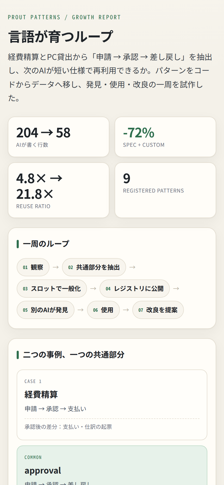

# PROUT（プラウト）

**AIが書き、AIが検証し、人間は自然言語とGUIで読む。**

[](https://github.com/RyujiHashimoto/prout-lang/actions/workflows/ci.yml)

PROUTは、AIによるソフトウェア開発のために設計した言語の試作です。人間の言語を置き換えるのではなく、**AIが仕様を書き、別のAIが契約を検査し、人間が結果を理解する**ための共通の形を目指しています。

作者: 橋元 龍二（Ryuji Hashimoto） / [@RyujiHashimoto](https://github.com/RyujiHashimoto)

## 出発点

AIが開発するなら、人間が作った言語の制約から自由になれるはずです。しかし、あらゆる言語の厳密な上位互換は作れません。意味論も構文もランタイムも衝突するからです。

そこでPROUTは、実装言語を置き換えず、その上に**契約と効果の層**をかぶせます。`impl` はPythonでもRustでもSQLでもよい。PROUTが保証するのは「何を読み、何を書き、何を約束するか」です。

その上に、もう一つの層を置きました。**PROUT Patterns** です。人間が欲しがるWebアプリの形は、驚くほど限られたパターンの組み合わせでできています。認証、一覧、作成、検索、決済、返金、通知、アップロード、承認。ならばパターン自体を言語の第一級要素にし、AIがコードを書く代わりにパターンとスロットを書くようにすれば、開発は速くなります。

## 二つの層

| 層 | ファイル | 役割 |
|---|---|---|
| 契約言語 PROUT | `prout.py`, `SPEC.md` | 型・効果・事前条件・ポリシーを検査し、ASTハッシュと人間向けGUIを生成する |
| パターン言語 PROUT Patterns | `patterns/proutc.py`, `patterns/registry/` | パターンをJSONで定義し、仕様のスロットを埋めて数百行を決定論的に展開する |

パターンはコードではなくデータです。だからAIは、コードを読まずに `registry/index.json` から目的のパターンを発見し、マニフェストの `intent` と `slots` だけを読んで使えます。

## 動かす

Python 3.12だけで動きます。追加の依存はありません。

```bash
git clone https://github.com/RyujiHashimoto/prout-lang.git
cd prout-lang

# 契約言語：壊れた初稿は3件のエラーで止まる
python3 prout.py check examples/refund_broken.prout

# 修正版はエラー0件、実行時ガード1件
python3 prout.py check examples/refund_fixed.prout

# ASTから人間向けGUIを生成
python3 render.py
open human-view.html
```


`demo.sh` はここまでをまとめて実行します。

## 承認前後をGUIで確かめる

`proutc.py build` は `report.html` に加えて `demo.html` を生成します。承認パターンを含む仕様なら、申請→承認→差し戻しをブラウザで操作でき、承認後にだけ `on_approved` の処理が動くことを確認できます。

```bash
cd patterns
python3 proutc.py build examples/expense.prout --out build/expense
open build/expense/demo.html
```


## パターンで書く

```bash
cd patterns

# 38行の仕様から、1,581行相当のファイル構成を展開する
python3 proutc.py build examples/shop.prout

# 日本語でパターンを検索する
python3 proutc.py find "申請 承認"

# 経費精算を、承認デモ付きで組む
python3 proutc.py build examples/expense.prout --out build/expense

# PC貸出は、承認パターンを二つのアプリから抽出するための利用例
python3 proutc.py build bench/pc_lending.prout --out build/pc_lending

# パターン追加前後を比較する
python3 proutc.py bench
```

PC貸出は、承認パターンを二つのアプリから抽出するために使った二つ目の利用例です。製品デモとして育てる予定はなく、再利用が効いた証拠としてベンチに残しています。

`find "申請 承認"` は `approval` を score 12 で返します。元の会話を知らないAIでも、この索引とマニフェストだけで「申請→承認→差し戻し」を再利用できます。

### パターン追加前後

| ケース | 仕様 | custom | AIが書く行数 | 生成行数 | 再利用倍率 |
|---|---:|---:|---:|---:|---:|
| 経費精算（approval追加前） | 24 | 180 | 204 | 981 | 4.8x |
| 経費精算（approval追加後） | 28 | 30 | **58** | 1,264 | **21.8x** |
| PC貸出（approval再利用） | 28 | 35 | **63** | 1,269 | **20.1x** |

同じ「申請→承認→差し戻し」を二度目に書くとき、AIの記述量は204行から58行へ **72%減**、再利用倍率は4.8倍から21.8倍へ改善しました。パターンが言語に追加されたことで、次の開発が短くなったことを示す最初の測定です。

## 言語が育つループ

PROUTの成長は、コードの行数ではなく、**次のAIが少ない手順で解けるようになったか**で測ります。

1. 観察 — 二つのアプリに同じ形が現れる。
2. 共通部分を抽出する — 経費精算とPC貸出の「申請→承認→差し戻し」。
3. スロットで一般化する — `entity`, `approver`, `on_approved`。
4. レジストリに公開する — JSONマニフェストと索引。
5. 別のAIが発見する — `index.json` と `find`。
6. 使用する — 必須スロットを埋め、`on_approved` でアプリ固有の処理を接続する。
7. 改良を提案する — Pull RequestとCI。



`patterns/growth_report.py` は、この一周をHTMLレポートにします。ベンチ結果とレジストリから自動生成されるので、パターンを追加するたびに数値が更新されます。

## これは「全言語の上位互換」ではない

意味論・構文・ランタイムが衝突するため、厳密な上位互換は作れません。PROUTは実装言語を置き換えず、その上に契約と効果の層をかぶせるメタ言語です。

リバースエンジニアリングへの含意は `SPEC.md` に書きました。契約が存在し、検証されている場合に限り、意味の復元は契約の照合に変わります。契約のないバイナリの解析は、依然として難しいままです。

## リポジトリ構成

```
prout.py                 契約言語のパーサー・検証器・CLI
render.py                ASTから人間向けHTMLを生成
SPEC.md                  契約言語の仕様と設計原則
examples/                壊れた初稿と修正版
patterns/
  proutc.py              パターンコンパイラ（build / find / add / index / bench）
  PATTERNS.md            パターン言語の設計思想
  registry/              9個のパターンマニフェストと index.json
  examples/              ショップ、経費精算の仕様
  bench/                 パターン追加前後の比較（PC貸出を含む）
  build/                 生成物（report.html、承認デモの demo.html）
  growth_report.py       成長ループのHTMLレポート
.github/workflows/ci.yml 契約検査、索引整合、ビルド、ベンチ、回帰ガード
CONTRIBUTING.md          パターン提案とレビューの基準
```

## 参加する

新しいパターンは `patterns/registry/<name>.json` を追加し、`python3 proutc.py index` で索引を更新してPull Requestを出します。AIが生成した提案も歓迎しますが、人間のレビューは必須です。

詳しくは [CONTRIBUTING.md](CONTRIBUTING.md) と [patterns/registry/README.md](patterns/registry/README.md) を参照してください。

## ライセンス

MIT。Copyright (c) 2026 橋元 龍二（Ryuji Hashimoto）。
