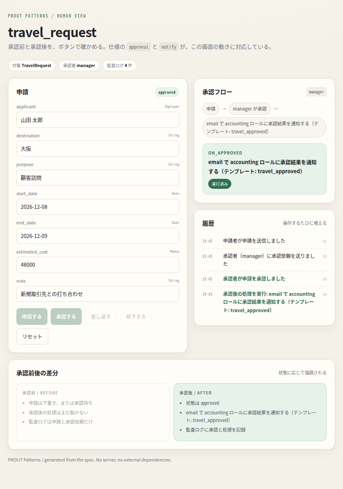

# PROUT

**Contracts for AI agents: declare effects and approvals, catch unsafe automations before they run.**

[日本語](README.ja.md) · [Spec (English)](SPEC.en.md) · [Spec (Japanese)](SPEC.md)

[](https://github.com/RyujiHashimoto/prout-lang/actions/workflows/ci.yml)

PROUT statically checks what an AI agent is allowed to do before that agent runs. The agent declares its effects and the human approvals those effects require. A separate checker rejects an unsafe automation. A human reads the summary and the GUI.

Author: Ryuji Hashimoto (J-PROUT Inc.)

## What the checker is for

An automation is unsafe when it can send mail, take a payment, or change a contract without a bound that was checked ahead of time. PROUT is that bound.

| Bound | On this tree | Landing next |
|---|---|---|
| Effects (`read`, `write`, `net`, `spend`, `emit`) must be declared, and the declaration must match the implementation | `prout.py` rejects a mismatch with `E-EFF` | |
| Network targets must sit on the allow list (default `stripe`) | `E-POLICY` | |
| Preconditions the checker can disprove | `E-PRE`. Unproved conditions stay visible as `W-PRE` runtime guards | |
| Canonical AST hash for the audit trail | Printed by `prout check`, stamped on the human view | |
| A human approves before the next side effect | Pattern `approval`, interactive `demo.html` | |
| Spend and rate budgets (per run, per period) | The effect name `spend` exists. Numeric budgets do not | [PR #10](https://github.com/RyujiHashimoto/prout-lang/pull/10) pattern layer |
| A mandatory human gate before an external email, a payment, or a contract change | | [PR #10](https://github.com/RyujiHashimoto/prout-lang/pull/10) `approval_gate` |
| `agent` / `task` syntax | The parser does not accept these declarations | Pattern-layer draft in PR #10. Contract-layer pull request still to come |

`impl` may be Python, Rust, or SQL. PROUT records what that implementation may read, write, charge, and promise. It is not a superset of those languages.

## Why it exists

AI writes the specification. A different program verifies it. Humans read a natural-language summary and a GUI.

General-purpose languages optimize for a person at the keyboard. An agent needs an envelope that can be checked before the first side effect: which effects are allowed, which of them wait for a person, and which hash identifies the contract that allowed the run. The same split, applied to ordinary app specs, is the pattern layer below.

## Quickstart

Python 3.12 and the standard library. No extra packages.

```bash
git clone https://github.com/RyujiHashimoto/prout-lang.git && cd prout-lang
python3 prout.py check examples/refund_fixed.prout
python3 patterns/proutc.py build patterns/examples/expense.prout --out patterns/build/expense
```

The second command checks a repaired refund. On this tree it exits 0, prints AST hash `bae8501e8b3f`, and leaves one runtime guard (`W-PRE`: `order.status == "paid"`). The flow's effects match the operations it calls. The third command expands a 28-line expense spec and writes `patterns/build/expense/demo.html`. Open that file. No server. Submit, approve, send back, and reject. The approved step runs only after approval.

`patterns/build/` is gitignored. `./demo.sh` reruns the contract check and regenerates `human-view.html`. The intentionally broken draft `examples/refund_broken.prout` must fail `prout check`.



```bash
python3 -m unittest discover -s tests -v
```

133 tests, stdlib `unittest` only.

### Install the commands locally

The package is not on PyPI. From a clone:

```bash
python3 -m venv .venv
.venv/bin/pip install .
.venv/bin/prout check examples/refund_fixed.prout
.venv/bin/proutc build patterns/examples/expense.prout --out patterns/build/expense
```

`prout` and `proutc` call the existing `main` functions. Checker source is unchanged. An installed `proutc` reads the registry copied into the virtualenv. Day-to-day work can keep using `python3 prout.py` and `python3 patterns/proutc.py`.

## Contract layer

A contract names the operation, the effects it may perform, and the conditions the caller must meet. Abbreviated from [`examples/refund_fixed.prout`](examples/refund_fixed.prout):

```prout
op refund(order: Order, amount: Money) -> Receipt
  doc "注文を指定額だけ返金する"
  eff write(payments), net(stripe)
  pre amount <= order.total
  pre order.status == "paid"
  post result.status == "refunded"
  impl stripe.refund(order, amount)

flow handle_refund(order_id: Id) -> Receipt
  doc "返金リクエストを処理する"
  eff read(orders), write(payments), net(stripe)
  let order = orders.get(order_id)
  let receipt = refund(order, order.total)
  return receipt
```

The flow's effects must equal the effects of the operations it calls. A flow that pays without declaring `spend`, or that omits `return`, does not pass. The checker also accepts `spend(stripe)` and `emit(audit)` as effect kinds. A network target outside the allow list is `E-POLICY`.

`python3 render.py` rebuilds [`human-view.html`](human-view.html) from the AST, including the hash. The view is a rendering of the AST.


Full rules: [SPEC.en.md](SPEC.en.md). The Japanese [SPEC.md](SPEC.md) is the original.

## Pattern layer

App specs fill slots. The compiler checks them and expands each pattern into an estimated set of database, API, UI, and test files. It does not yet write those source files. Line counts are estimates from the manifests.

Human approval before a later step, from [`patterns/examples/expense.prout`](patterns/examples/expense.prout) and [`patterns/examples/travel_request.prout`](patterns/examples/travel_request.prout):

```prout
pattern approval Expense
  entity: Expense
  approver: manager
  on_approved: reimburse

pattern notify
  channel: email
  recipient: accounting
  template: travel_approved

pattern approval TravelRequest
  entity: TravelRequest
  approver: manager
  on_approved: notify
```

`on_approved` must name a `custom` block or a pattern applied in the same spec. Pointing it at `notify` checks `channel` (`email` or `slack`) and `recipient` (one of `auth.roles`). A bad argument is `E-HOOK-ARG`. An unknown target is `E-HOOK`.

```bash
python3 patterns/proutc.py find "approval"
python3 patterns/proutc.py find "申請 承認"
```

`find "申請 承認"` returns `approval` at score 15. Patterns are JSON, so another agent can discover one from [`patterns/registry/index.json`](patterns/registry/index.json) without reading the compiler.

### Agent tasks, in progress

Pull request [#10](https://github.com/RyujiHashimoto/prout-lang/pull/10) adds the pattern-layer envelope this README leads with: an `ai_task` declares the effects an agent may use, spend and rate budgets, retry, an idempotency key, and an audit hash. An `approval_gate` stops an external email, an external network call, a payment, or a contract change until a person approves. A spec that emits outside the organization with no gate fails `E-POLICY` on that branch.

`agent` / `task` declarations in the contract language are not on main. A contract-layer pull request is still to come. Until it lands, `prout check` will reject those keywords as unknown syntax. The quickstart above does not depend on either pull request.

## Measured reuse

Growth is "the next agent writes less." [`patterns/bench/report.json`](patterns/bench/report.json) compares specs before and after the `approval` pattern existed. Reuse is the generated-line estimate divided by AI-written lines (spec plus custom).

| Case | Spec | Custom | AI-written lines | Generated estimate | Reuse |
|---|---:|---:|---:|---:|---:|
| Expense, before `approval` | 24 | 180 | 204 | 981 | 4.8× |
| Expense, after `approval` | 28 | 30 | 58 | 1,264 | 21.8× |
| Travel request, `approval` reused | 33 | 0 | 33 | 1,386 | 42.0× |
| Equipment purchase, `approval` reused | 34 | 0 | 34 | 1,394 | 41.0× |
| PC lending (bench only) | 28 | 35 | 63 | 1,269 | 20.1× |

The single-build "expansion" figure divides by spec lines only, so it is larger than reuse. PC lending shows the pattern transferred. It is a bench, not a product demo. The write-up of two trials with an agent that had not seen the design conversation is in [README.ja.md](README.ja.md).

## Features

- Contract language: types, `op`, `flow`, effects, `pre` / `post`, `impl`.
- Checks for types, effect completeness, linear-arithmetic preconditions, and network policy.
- Canonical AST and a SHA-256 prefix, so two equivalent specs share a hash.
- Diagnostics an agent can repair from: code, location, expected, actual, suggestion.
- Human HTML generated from the AST (`render.py`).
- 24 pattern manifests, an index, and `find` over intent, tags, name, and slot text.
- `build` writes `report.html`, `manifest.json`, and, for a valid approval spec, interactive `demo.html`. Scene specs also write `story.html`.
- Hook checks for `notify`. Unknown slots warn (`W-SLOT`).
- Service-desk patterns (assignment, queue, due date, checklist, comments, labels, activity, CSV, archive, survey).
- CI: unit tests, both checkers, registry index, example builds, bench regression guard.

## Industry example: a staffing desk

The pattern layer also describes one industry. [`patterns/examples/staffing.prout`](patterns/examples/staffing.prout) is a fictional staffing desk: staff, openings, a dispatch contract, a timesheet the client site must approve, and a bill rate that must stay at or above the pay rate. Statutory numbers are configuration. The language does not embed them.

```prout
pattern dispatch_contract
  entity: DispatchContract
  staff: Staff
  client: Client
  start_date: 2026-04-01
  end_date: 2027-03-31
  conflict_date: 2029-04-01

pattern staffing_billing
  entity: Invoice
  timesheet: Timesheet
  bill_rate: 2800
  pay_rate: 1800
```

```bash
python3 patterns/proutc.py build patterns/examples/staffing.prout --out patterns/build/staffing
```

That build is 104 spec lines, an estimated 3,383 generated lines, 32.5×, and 0 errors. The contract-layer twin, [`examples/staffing.prout`](examples/staffing.prout), encodes money as integer yen and dates as day counts: 0 errors, 3 runtime guards. Design and limits: [docs/staffing.md](docs/staffing.md).

## Status and roadmap

Prototype. No release tag. Not published to PyPI. `build` emits a report, a demo, and a manifest. It does not emit API or database source.

1. Finish the pattern-layer agent envelope in [PR #10](https://github.com/RyujiHashimoto/prout-lang/pull/10): budgets, external-effect gates, audit hash.
2. Open the contract-layer pull request for `agent` / `task` syntax. That syntax is not in `prout.py` on main.
3. Emit `approval`'s artifacts as real files and run their tests.
4. Declare arguments on `custom` hooks. Hooks that point at a standard pattern are checked already.
5. Information-flow labels (`pii`, `secret`) so a value cannot reach a forbidden sink. Design only: [docs/information-flow.md](docs/information-flow.md) (Japanese).

[PR #9](https://github.com/RyujiHashimoto/prout-lang/pull/9) proposes `Date` and `Decimal` literals in the contract layer. Main still uses integer yen and day counts for those examples.

Why this is not a superset of every language: [SPEC.en.md](SPEC.en.md). `1/2`, generics syntax, and undefined behavior cannot be given one meaning. The contract sits on top of an implementation language.

## Documentation

| Doc | Language | Contents |
|---|---|---|
| [SPEC.md](SPEC.md) | Japanese, original | Contract language and design rules |
| [SPEC.en.md](SPEC.en.md) | English translation | Same document. If they disagree, `SPEC.md` wins |
| [patterns/PATTERNS.md](patterns/PATTERNS.md) | Japanese | Pattern language |
| [patterns/registry/README.md](patterns/registry/README.md) | Japanese | How an agent should read a manifest |
| [docs/staffing.md](docs/staffing.md) | English summary, then Japanese | Staffing example, limits, owner questions |
| [docs/information-flow.md](docs/information-flow.md) | Japanese | Label design. Checker support is later |
| [CONTRIBUTING.md](CONTRIBUTING.md) | English, short Japanese section | Patterns, review, tests |
| [SECURITY.md](SECURITY.md) | English | How to report a vulnerability |
| [CODE_OF_CONDUCT.md](CODE_OF_CONDUCT.md) | English | Contributor Covenant 2.1 |
| [CHANGELOG.md](CHANGELOG.md) | English | Unreleased notes |
| [docs/launch-checklist.md](docs/launch-checklist.md) | Japanese | Owner decisions before a public launch |

## Repository

```
prout.py                 contract parser, checker, CLI
render.py                AST to human HTML
patterns/proutc.py       pattern compiler (build, find, add, index, bench)
patterns/registry/       24 manifests and index.json
patterns/examples/       shop, expense, travel, equipment, repair, support, stories, staffing
patterns/bench/          before/after approval, including PC lending
examples/                contract samples, including broken ones
tests/                   unittest
```

## Contributing

New patterns are JSON files in `patterns/registry/`. Human review is required, including when an agent wrote the patch. See [CONTRIBUTING.md](CONTRIBUTING.md).

## License

[MIT](LICENSE). Copyright (c) 2026 Ryuji Hashimoto (J-PROUT Inc.).
