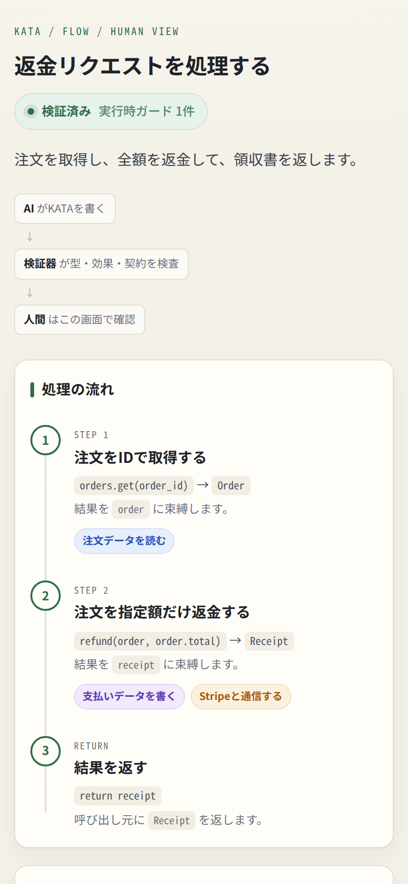

# PROUT

**Contracts for AI agents: declare effects and approvals, catch unsafe automations before they run.**

[日本語](README.ja.md) · [Spec (English)](SPEC.en.md) · [Spec (Japanese)](SPEC.md)

[](LICENSE)
[](https://github.com/RyujiHashimoto/prout-lang/actions/workflows/ci.yml)
[](docs/playground/index.html)

It stops an agent from emailing a customer, charging a card, changing a contract, or calling a host that is not allowlisted, before any of those calls run. An AI writes the specification. A separate checker verifies it. A human reads the summary and the GUI.

Author: Ryuji Hashimoto (J-PROUT Inc.)



```prout
# before — E-POLICY, the send has no approval gate
task draft_reply(ticket_id: Id) -> Bool
  eff read(tickets), emit(mail)

# after — ask support_lead, then send
task draft_reply(ticket_id: Id) -> Bool
  eff read(tickets), emit(mail)
  gate approve_reply
```

[Try it in your browser](docs/playground/index.html). The page is static files under `docs/playground/`. It goes live once GitHub Pages is enabled for this repository, with `/docs` as the site source. This repository does not enable Pages by itself.

## Quickstart

Python 3.12 and the standard library. No extra packages.

```bash
git clone https://github.com/RyujiHashimoto/prout-lang.git && cd prout-lang
python3 prout.py check examples/agents/support_reply.prout
python3 patterns/proutc.py build patterns/examples/expense.prout --out patterns/build/expense
```

The second command checks a fictional support desk (Harbor Lane Support, ticket T-1042). The task may read the ticket. Emailing the customer is `emit(mail)`, marked external, and the task names `gate approve_reply`. The check exits 0. The checker reads the source. It does not send mail.

`examples/agents/support_reply_broken.prout` is the same desk with the gate left off the task. That check exits 1 with `E-POLICY`.

The third command expands a 28-line expense spec and writes `patterns/build/expense/demo.html`. Open that file. No server. Submit, approve, send back, and reject. The approved step runs only after approval. `patterns/build/` is gitignored.

Five-minute tour: [docs/en/agents-quickstart.md](docs/en/agents-quickstart.md). How this differs from a Cedar or OPA policy plus a wrapper: [docs/en/comparison.md](docs/en/comparison.md).

```bash
python3 -m unittest discover -s tests -v
```

Tests use stdlib `unittest` only.

### Install the commands locally

The package is not on PyPI. From a clone:

```bash
python3 -m venv .venv
.venv/bin/pip install .
.venv/bin/prout check examples/agents/support_reply.prout
.venv/bin/proutc build patterns/examples/expense.prout --out patterns/build/expense
.venv/bin/prout-mcp
```

`prout`, `proutc`, and `prout-mcp` are console scripts. `prout-mcp` is the same stdio server as `python3 prout.py mcp`. Nothing here uploads the package.

## What the checker enforces

| Bound | On this tree |
|---|---|
| Effects (`read`, `write`, `net`, `spend`, `emit`) match the operations a flow or task calls | `E-EFF` |
| A task's effects stay inside its agent's `allow` list | `E-POLICY` |
| External `emit` / `net`, every `spend`, and a `write` marked as a contract change name a human `gate` | `E-POLICY` |
| Network targets sit on the allow list (default `stripe`; override with `--allow-net`) | `E-POLICY` |
| Spend budgets are integer yen, and per-run does not exceed the period. Hourly `net` and `emit` limits are static | Declared and checked. Those running totals are not counted. `limit calls` and `limit spend` are counted by `prout guard` |
| `audit ast_hash` on the agent | Required. The full id is 64 hex digits. `prout check` prints the 12-digit prefix |
| Preconditions in linear arithmetic, including `Decimal` and calendar `Date` | False is `E-PRE`. Unproved is a visible `W-PRE` guard |
| Information-flow labels (`pii`, `secret`) when the program declares them | `E-IFLOW-*`, `E-DECLASS`. Programs with no labels keep their old AST hash |

The checker does not run cron, store the remaining integer-yen budget, or store idempotency keys. A gate stops the static check. It does not send the approval email. `impl` may be Python, Rust, or SQL. PROUT records what that implementation may read, write, charge, and promise.

Full rules: [SPEC.md](SPEC.md) (Japanese, the original) and [SPEC.en.md](SPEC.en.md).

## Contract layer

A repaired refund, abbreviated from [`examples/refund_fixed.prout`](examples/refund_fixed.prout). The flow's effects must equal the effects of the operations it calls.

```prout
op refund(order: Order, amount: Money) -> Receipt
  doc "注文を指定額だけ返金する"
  eff write(payments), net(stripe)
  pre amount <= order.total
  pre order.status == "paid"
  post result.status == "refunded"
  impl stripe.refund(order, amount)

flow handle_refund(order_id: Id) -> Receipt
  eff read(orders), write(payments), net(stripe)
  let order = orders.get(order_id)
  let receipt = refund(order, order.total)
  return receipt
```

`python3 prout.py check examples/refund_fixed.prout` exits 0 with one runtime guard (`W-PRE`: `order.status == "paid"`) and AST hash `bae8501e8b3f`. `python3 render.py` rebuilds [`human-view.html`](human-view.html) from the AST.



An agent envelope, abbreviated from [`examples/agents/support_reply.prout`](examples/agents/support_reply.prout):

```prout
policy
  external emit(mail)

agent support_reply
  allow read(tickets), emit(mail)
  budget run 0 period 0
  limit emit 20 hour
  audit ast_hash

gate approve_reply
  approver support_lead
  before emit(mail)
  on_approved mail.send_reply

task draft_reply(ticket_id: Id) -> Bool
  agent support_reply
  eff read(tickets), emit(mail)
  gate approve_reply
  key ticket_id
  retry 2 escalate support_lead
  let ticket = tickets.read(ticket_id)
  let sent = mail.send_reply(ticket)
  return sent
```

`budget run 0` is legal here because this agent is not allowed to `spend`. An agent that may `spend` needs a positive integer-yen budget. Design notes: [docs/ai_automation.md](docs/ai_automation.md).

## MCP

The same check is an MCP server. It speaks stdio and uses only the standard library. There is no `mcp` package to install.

```bash
python3 prout.py mcp
python3 prout.py import mcp examples/agents/tools/mcp_tools.json
python3 prout.py guard --contract examples/agents/support_reply.prout -- python3 path/to/upstream_server.py
```

`prout_check`, `prout_import_tools`, `prout_explain`, and `prout_check_plan` are read-only. `prout guard` forwards `tools/list` to an upstream server and applies the contract before each `tools/call`. `prout approve` issues a signed, expiring, one-time approval; `ASK` is forwarded only when that approval matches the contract, the gate, the tool, and the argument hash. `limit calls` and `limit spend` are counted in a ledger file, and a signed approval does not raise those caps. Setup: [docs/en/mcp.md](docs/en/mcp.md) and [docs/mcp.ja.md](docs/mcp.ja.md).

## Prompt injection

A fictional inquiry, Q-4401 from `guest@example.invalid`, tells Harbor Lane Desk to ignore its rules, forward a vault token, and refund 9000.00 JPY. Two contracts show the same story.

The leaking contract lets the secret token reach `mail.forward`. The check rejects it:

```bash
python3 prout.py check examples/prompt_injection_leak.prout
```

Expected: exit 1, `E-IFLOW-ARG` at `mail.forward` (`argument 'note' of mail.forward expects no labels, got secret`).

The safe contract keeps the token inside the vault and answers with a fixed public sentence. External mail and the refund wait for `desk_lead`. The refund is a decimal in JPY and is capped at 1000.00 per day.

```bash
python3 prout.py check examples/prompt_injection_safe.prout
```

Expected: exit 0, no errors.

Against that safe contract, `prout guard` treats the calls as follows.

| Call | Verdict | Why |
|---|---|---|
| `inbox.read` | `ALLOW` | A read inside the agent allow list |
| `mail.reply` | `ASK` | External `emit(mail)` waits for `desk_lead` |
| `mail.forward` | `BLOCK` | The op is not in the contract |
| `payments.refund` of `100.00` with a matching signed approval | forwarded | Under the 1000.00 JPY daily cap |
| `payments.refund` of `9000.00` with a matching signed approval | `BLOCK` | The signature fits the call, and the cap still rejects it |

The approval is issued with `prout approve` for that op, gate `approve_reply`, approver `desk_lead`, and the same argument object the client will send. The guard needs the same HMAC key, a nonce file, and `--ledger-file`.

## Pattern layer

App specs fill slots. The compiler checks them and estimates database, API, UI, and test files. It does not yet write those source files.

```bash
python3 patterns/proutc.py find "approval"
python3 patterns/proutc.py find "申請 承認"
```

`find "申請 承認"` returns `approval`. The registry has 27 manifests, including `overtime_agreement`, `ai_task`, and `approval_gate`. Patterns are JSON, so another agent can discover one from [`patterns/registry/index.json`](patterns/registry/index.json) without reading the compiler.

[`patterns/bench/report.json`](patterns/bench/report.json) compares specs before and after `approval` existed. Reuse is the generated-line estimate divided by AI-written lines (spec plus custom).

| Case | Spec | Custom | AI-written lines | Generated estimate | Reuse |
|---|---:|---:|---:|---:|---:|
| Expense, before `approval` | 24 | 180 | 204 | 981 | 4.8× |
| Expense, after `approval` | 28 | 30 | 58 | 1,264 | 21.8× |
| Travel request, `approval` reused | 33 | 0 | 33 | 1,386 | 42.0× |
| Equipment purchase, `approval` reused | 34 | 0 | 34 | 1,394 | 41.0× |
| PC lending (bench only) | 28 | 35 | 63 | 1,269 | 20.1× |

The longer trial write-up is in [README.ja.md](README.ja.md).

## Industry example: a staffing desk

[`patterns/examples/staffing.prout`](patterns/examples/staffing.prout) is one industry, not the center of the language. It is a fictional staffing desk: staff, openings, a dispatch contract, a timesheet the client site must approve, a 36-agreement whose limits are slots, and a bill rate at or above the pay rate. Omitted agreement limits default to the general statutory ceilings, and a higher cap is an error. The conflict date is both the date the client notified and a date calculated from the earliest dispatch start at the same office and for the same person and organizational unit. The compiler reads the spec only. Live hours and stored contracts are described as runtime checks and are not evaluated. Social-insurance rates and equal-pay determinations are out of scope.

```bash
python3 patterns/proutc.py build patterns/examples/staffing.prout --out patterns/build/staffing
```

Design and limits: [docs/staffing.md](docs/staffing.md). The contract layer can also write those dates and decimal rates directly. See `examples/staffing_dates.prout`.

## Features

- Contract language: types, `op`, `flow`, `agent`, `task`, `gate`, effects, `pre` / `post`, `impl`.
- Effect completeness, network allow list, human gates for external mail, payment, and contract changes, integer-yen budgets, hourly rate limits, retry bounds, and a required audit hash.
- `Decimal` and calendar `Date` in preconditions. `1/2` is still not given one meaning.
- Information-flow labels. Programs that do not use them keep their previous AST hash.
- Diagnostics an agent can repair from: code, location, expected, actual, suggestion.
- Human HTML from the AST (`render.py`) and a static browser playground (`docs/playground/`).
- Import of MCP and OpenAI tool lists into `op` declarations (`prout import`).
- MCP server and a stdio guard (`prout mcp`, `prout guard`, `prout-mcp`).
- 27 pattern manifests, `find`, and an approval `demo.html`.
- CI on GitHub Actions.

## Status

Prototype. No release tag. Not published to PyPI. `build` emits a report, a demo, and a manifest. It does not emit API or database source. Cron does not run, budget counters are not stored, and there is no idempotency store. Information-flow checking does not follow implicit flow through branches.

## Documentation

| Doc | Language | Contents |
|---|---|---|
| [SPEC.md](SPEC.md) | Japanese, original | Contract language, v0.6 |
| [SPEC.en.md](SPEC.en.md) | English translation | Same document. If they disagree, `SPEC.md` wins |
| [docs/en/agents-quickstart.md](docs/en/agents-quickstart.md) | English | Five-minute agent check |
| [docs/en/comparison.md](docs/en/comparison.md) | English | Cedar, OPA, guardrails, effect systems |
| [docs/en/mcp.md](docs/en/mcp.md) | English | MCP server and guard |
| [docs/mcp.ja.md](docs/mcp.ja.md) | Japanese | MCP server and guard |
| [docs/playground/index.html](docs/playground/index.html) | Browser | Static checker. Needs GitHub Pages to be public |
| [docs/ai_automation.md](docs/ai_automation.md) | Japanese | Agent and task design |
| [docs/information-flow.md](docs/information-flow.md) | Japanese | Label design and current limits |
| [docs/staffing.md](docs/staffing.md) | English summary, then Japanese | Staffing example |
| [patterns/PATTERNS.md](patterns/PATTERNS.md) | Japanese | Pattern language |
| [CONTRIBUTING.md](CONTRIBUTING.md) | English, short Japanese section | Patterns, review, tests |
| [SECURITY.md](SECURITY.md) | English | How to report a vulnerability |
| [CODE_OF_CONDUCT.md](CODE_OF_CONDUCT.md) | English | Contributor Covenant 2.1 |
| [CHANGELOG.md](CHANGELOG.md) | English | Unreleased notes |
| [docs/launch-checklist.md](docs/launch-checklist.md) | Japanese | Owner decisions before a public launch |

## Repository

```
prout.py                 contract parser, checker, CLI
prout_api.py             check_source and check_file
prout_import.py          MCP and OpenAI tool lists become ops
prout_mcp/               MCP server (prout mcp) and guard (prout guard)
render.py                AST to human HTML
patterns/proutc.py       pattern compiler (build, find, add, index, bench)
patterns/registry/       27 manifests and index.json
examples/agents/         agent contracts, including broken ones
docs/playground/         browser checker (static, Pyodide)
```

## Contributing

New patterns are JSON in `patterns/registry/`. Human review is required, including when an agent wrote the patch. See [CONTRIBUTING.md](CONTRIBUTING.md). Agents changing this repository should start with [AGENTS.md](AGENTS.md).

## License

[MIT](LICENSE). Copyright (c) 2026 Ryuji Hashimoto (J-PROUT Inc.).
